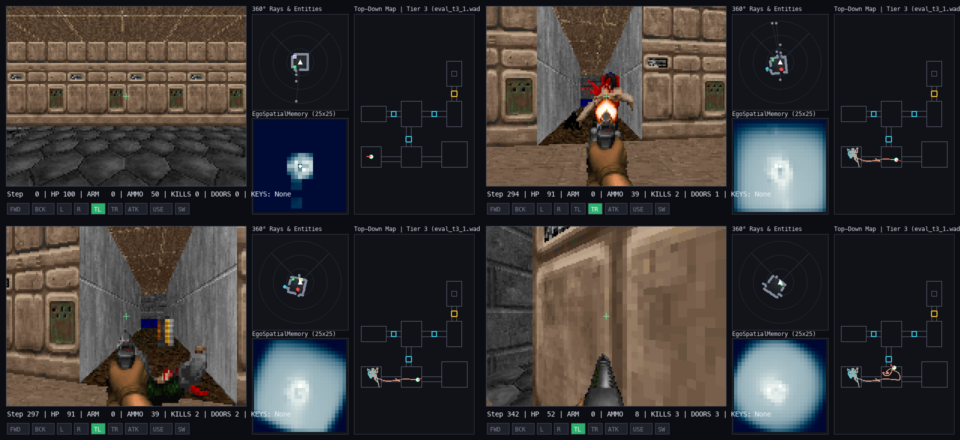
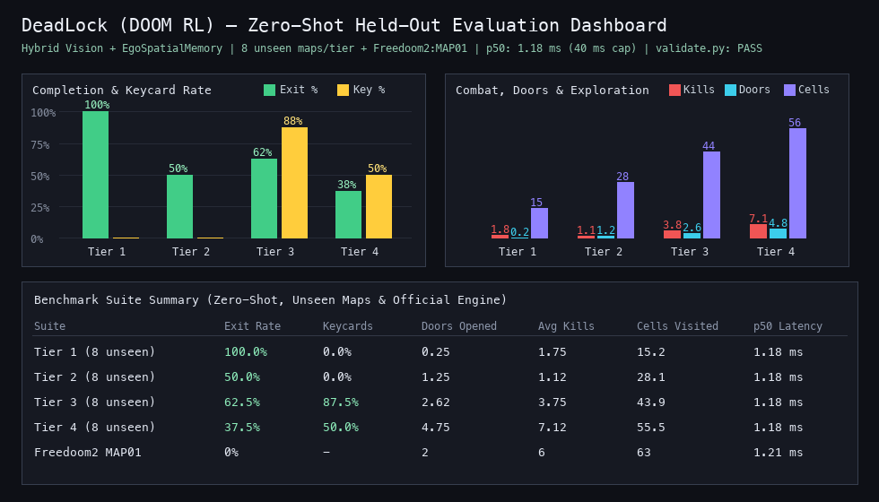
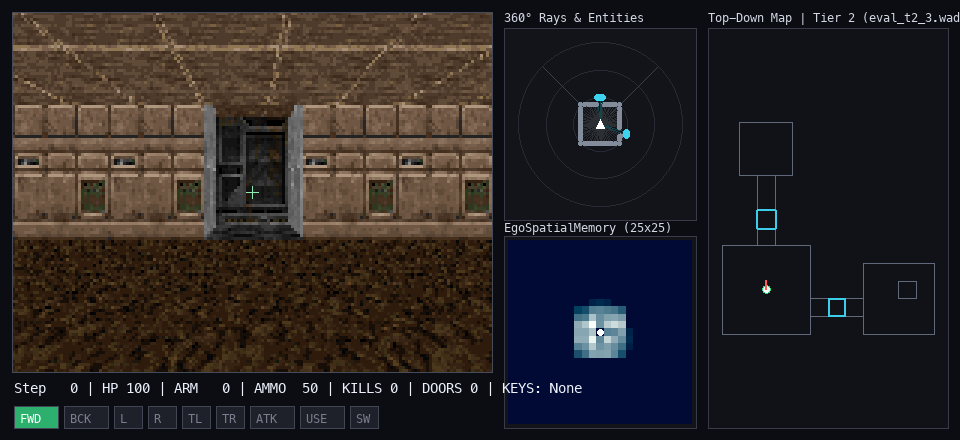
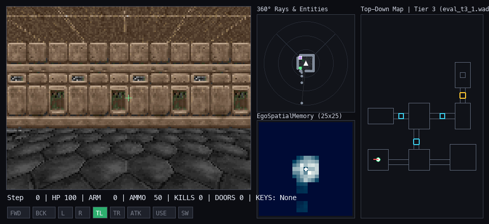
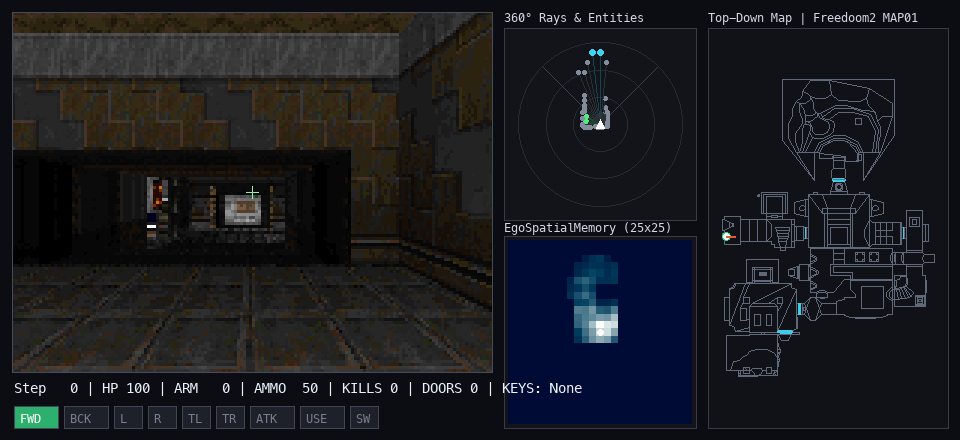
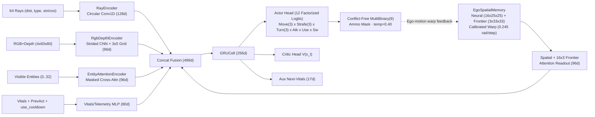
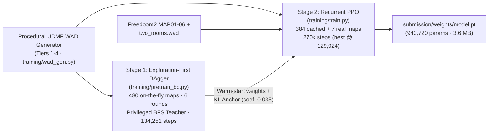

# DeadLock — Hybrid Vision & Frontier-Memory DOOM RL Agent

Submission for **Yugaantar 2026 · DevForge — Track 1: "Can It Play DOOM?"**

**DeadLock** is a custom pure-PyTorch reinforcement learning agent (**940,720 parameters · 3.6 MB via Git LFS**) trained from scratch to play **unseen DOOM levels zero-shot** under partial observability. Without any hardcoded A*/BFS pathfinding or rule trees at test time, it navigates multi-room layouts, fights enemies, opens unlocked doors with `USE`, bounces cleanly off locked doors when holding zero keys, picks up colored keycards, backtracks to unlock progression doors, and reaches level exits at **1.18–1.4 ms per decision** on a single CPU thread.

---

## Live Interactive Deployments & Reports

| Resource | Link | Description |
| --- | --- | --- |
| **Public Cloud Demo (Hugging Face Spaces · Gradio + ZeroGPU)** | https://omrajput977-deadlock-doom.hf.space/ | Live interactive browser demo ([Space Repo](https://huggingface.co/spaces/OmRajput977/deadlock-doom)) — pick any Tier 1–4 or Freedoom2 map, seed, FPS, and temperature |
| **Local Live Web Demo (`training/web_demo.py`)** | http://127.0.0.1:7860/ | Zero-dependency local MJPEG/JSON web server streaming all 4 diagnostic panels live |
| **Technical Reports** | [Project Brief (PDF)](docs/DeadLock_Project_Brief.pdf) · [Research Report (PDF)](docs/DeadLock_Research_Report.pdf) | 2-page executive brief and IEEE/ICLR-style technical paper |

---

## Visual Showcase (4-Panel Agent Telemetry)

Every replay and live stream renders four synchronized diagnostic views of the agent's perception and memory:
1. **First-Person RGB + Action HUD:** Raw 160×120 RGB view overlaid with live health, ammo, keycards, step count, and active keys (`FWD`, `TURN`, `ATK`, `USE`).
2. **360° Ray Radar:** All 64 ego-centric raycasts color-coded by hit type (walls, unlocked doors, locked doors, enemies).
3. **EgoSpatialMemory Heatmap:** Live top-down view of the agent's internal `3×33×33` persistent frontier map (visited breadcrumbs, unexplored doors, and remembered locked doors).
4. **Top-Down Trajectory:** Ground-truth map path showing rooms explored, doors opened, enemies eliminated, keycards collected, and exit reached.

### Tier 3 (Keycard + Locked Door + Backtracking) Storyboard


### Zero-Shot Evaluation Dashboard (8 Unseen Maps per Tier + Freedoom2 MAP01)


### Live Gameplay Replays (Unseen Maps)

| Tier 2 — Multi-Room Doors & Combat | Tier 3 — Keycard Pickup & Backtracking | Freedoom2 MAP01 — Unmodified Retail Level |
| :---: | :---: | :---: |
|  |  |  |

*(Additional Tier 1 corridor navigation replay: [tier1_replay.gif](docs/assets/tier1_replay.gif))*

---

## Why Unseen DOOM Levels Are Hard

Playing procedural and retail DOOM maps zero-shot poses four coupled challenges under partial observability:
1. **Door `USE` vs. Shooting:** Naive RL agents mistake closed doors for walls or enemies and waste ammo shooting them.
2. **Locked-Door Backtracking:** When the agent encounters a red/blue/yellow locked door with zero keys, it must **not** get stuck hugging the door—it must turn away, explore other branches, pick up the matching keycard, and **remember where the locked door was** so it can backtrack.
3. **Exit Recognition Beyond 2D Rays:** Floor exit pads (`GATE3`) and wall exit switches (`SW1BRCOM`) are invisible to horizontal 2D raycasts; only visual RGB+Depth perception can spot them.
4. **Strict Single-CPU Budget:** Evaluation runs on 1 CPU core with an 8 GB RAM cap and no external packages beyond the official base image (`torch`, `numpy`, `gymnasium`, `vizdoom`).

---

## Model Architecture (`DoomSpatialPolicy`)

Implemented in [submission/model.py](submission/model.py) and [submission/agent.py](submission/agent.py) using pure `torch` + `numpy`:



1. **Direction-Preserving Circular Ray Encoder (`RayEncoder`, `128d`):**
   - Processes all 64 360° ego-centric raycasts (`distance` + 6 one-hot `hit_type` classes + `sin/cos` bearings) with a 3-layer **Circular 1D CNN** (`padding_mode="circular"`), preserving 360° wrap-around continuity alongside 16 angular sectors and a 9-ray front cone (`[-22.5°, +22.5°]`).
2. **Vision + Depth Spatial-Band Encoder (`RgbDepthEncoder`, `96d`):**
   - 3-layer strided ConvNet over concatenated `4×60×80` RGB + Depth frames preserving a `(3×5)` horizon/floor band grid (`24×3×5 → 96d`) to detect floor exit pads (`GATE3`), wall exit switches (`SW1BRCOM`), and colored keycard door trims.
3. **Masked Entity Set Cross-Attention (`EntityAttentionEncoder`, `96d`):**
   - Permutation-invariant attention over variable numbers (`0–32`) of visible entities (enemies, keycards, health, ammo, barrels) queried by ray + vitals context with NaN-safe empty-mask handling.
4. **Dual Neural + Persistent Geometric Frontier Memory (`EgoSpatialMemory`, `96d`):**
   - **Neural Grid `(16, 25, 25)` (`±1200` units):** Splats current ray/entity hits, warps via ego-motion, updates with a gated `3×3` conv cell, and reads out via vitals-conditioned spatial attention.
   - **Persistent Frontier Map `(3, 33, 33)` (`±1920` units):** Accumulates 3 non-decaying geometric channels via element-wise `max`:
     - `Ch0 Visited`: `1×1` (`120×120`-unit) footprint breadcrumbs so adjacent doorways aren't masked; attenuates to `0.25×` on new keycard pickup so backtracking paths look fresh.
     - `Ch1 Unexplored Doors`: Detected doorway hits minus `0.75 × Visited` to spotlight unvisited branches.
     - `Ch2 Locked Doors`: Persists sighted locked-door locations across rooms so the agent can return after collecting a keycard.
   - **Calibrated Ego-Motion Warp:** Warps both maps via `F.affine_grid` + `F.grid_sample` using measured ViZDoom turn rate (`0.245` rad/step ≈ `14.0625°` per 4-tic turn) and reads `16` radial angles × `3` distances (`[140, 320, 560]` units).
5. **Control GRU, Telemetry & Conflict-Free Action Head:**
   - Feeds `vitals` + `prev_action` + smooth front-cone door/lock/wall signals & rising-edge `use_cooldown` into a `256`-dim `GRUCell`, driving actor, critic, and auxiliary next-vitals heads.
   - Outputs `12` factorized logits mapped deterministically to `MultiBinary(9)` (`temperature=0.40`), preventing self-canceling key holds (`FWD+BACK`, `TL+TR`) and masking `SELECT_NEXT_WEAPON` off while active ammo > 0.

---

## How We Trained This Model (`871` Unique Maps)

DeadLock uses a **two-stage imitation-to-RL pipeline** designed so the agent learns clean mechanics first and then refines long-horizon exploration and combat with reinforcement learning.



### Step 1: Procedural UDMF Map Generator ([training/wad_gen.py](training/wad_gen.py))
- Generates guaranteed-connected multi-room ZDoom UDMF PWADs (`TEXTMAP` inside 3-lump PWADs) directly in Python without external BSP tools, exporting both `.wad` files and training-only grid/door/key layout metadata across 4 difficulty tiers:
  - **Tier 1:** Simple corridors & light enemies.
  - **Tier 2:** Multi-room branching layouts with unlocked doors (`BIGDOOR2`) and combat.
  - **Tier 3:** Keycard + matching locked door (`RedCard`/`BlueCard`/`YellowCard`) requiring exploration and backtracking.
  - **Tier 4:** Large multi-room gauntlets with multiple enemies, keys, pickups, and locked progression.

### Step 2: Stage 1 — Exploration-First Privileged DAgger ([training/pretrain_bc.py](training/pretrain_bc.py))
- **Why DAgger First?** Pure RL from scratch rarely discovers rare sequences like *approach closed door → press `USE` once → wait for door to rise → walk through* or *bounce off locked door → find keycard → backtrack*.
- **Training-Only Privileged Teacher (`PrivilegedDoomTeacher`):** Explicitly allowed during training under competition `Rule §2`, this teacher has access to the map layout graph and runs BFS + tactical combat + `USE` timing. Crucially, it mixes optimal shortest-path runs with **`explore_first`** and **`probe_locked`** demonstrations (`_cur_exp_goal` hysteresis) so the student learns how to explore unknown rooms and cleanly turn away from locked doors when holding `0` keys.
- **Training Setup:**
  - `6` DAgger rounds × `80` episodes/round = **`480` unique on-the-fly procedural maps** (`134,251` total environment steps).
  - Scheduled mixing probability `β: 1.0 → 0.08` (gradually shifting control from teacher to student policy).
  - `96`-step truncated BPTT through `GRUCell(256)` + `EgoSpatialMemory`, optimizing factorized action cross-entropy, value targets, and auxiliary next-vitals prediction.
  - **Result:** Teaches `USE` timing, enemy aim calibration, and **`0.00` closed-door shots**.

### Step 3: Stage 2 — KL-Anchored Recurrent PPO ([training/env_wrapper.py](training/env_wrapper.py), [training/train.py](training/train.py))
- **Why PPO Second?** Imitation alone is bounded by teacher heuristics on unseen layouts and retail maps. Recurrent PPO lets the agent optimize true multi-room survival, exploration, and exit completion across diverse environments.
- **Training Pool (`391` maps in Stage 2, `871` unique maps combined with Stage 1):**
  - `384` cached procedural maps (`96` per tier across Tiers 1–4)
  - `6` retail-style `freedoom2.wad` levels (`MAP01–MAP06`)
  - `maps/two_rooms.wad`
- **Dense, Non-Farmable Reward Shaping (`ShapedDoomEnv`):**
  - `96×96`-unit episodic area coverage bonus (matching the competition exploration metric).
  - Monotonic keycard-approach and locked-door-approach shaping.
  - Post-keycard breadcrumb reset (`_post_key_mode`) so revisiting corridors toward the unlocked door is rewarded.
  - Anti-loop penalty when `_stale_steps > 24` and locked-door hug penalties.
- **Stabilized Recurrent PPO:**
  - Vectorized multi-process rollouts (`SubprocVecEnv`) with `gamma=0.995`, GAE, and truncated BPTT over `(gru_h, spatial_map, prev_action)`.
  - **`25`-update critic warmup** before updating the actor so the value baseline stabilizes first.
  - **Factorized KL Anchor (`coef=0.035`)** toward the Stage 1 DAgger policy to prevent catastrophic forgetting of door `USE` discipline and aim accuracy.
  - Trained for `270,000` parallel steps, with the winning checkpoint saved at step **`129,024`** into [submission/weights/model.pt](submission/weights/model.pt).

### Step 4: Iterative Engineering Progression (Ablations)
| Version | Mean Exit | Tier 3 Exit | Tier 4 Exit | Closed-Door Shots | Key Architectural / Training Fix |
| --- | --- | --- | --- | --- | --- |
| **v1 Baseline PPO** | 28.1% | — | — | > 0 | Shot closed doors instead of pressing `USE` |
| **v2 RGB+D + DAgger + KL** | 49.5% | 58.3% | 10.4% | **0.00** | Added `RgbDepthEncoder`, `use_cooldown`, and Teacher DAgger |
| **v4 + Frontier + Warp Fix (24m/t)** | **56.2%** | **70.8%** | **25.0%** | **0.00** | Added `3×33×33` Frontier Map, fixed `_warp_map` rotation sign, exploration-first DAgger |

---

## Zero-Shot Evaluation & Validator Results

All benchmarks below were evaluated zero-shot with [submission/weights/model.pt](submission/weights/model.pt) (`temperature=0.40`, **0.00 closed-door shots across every benchmark**):

### 8-Map-Per-Tier Dashboard Suite ([training/visualize.py](training/visualize.py))
| Benchmark | Exit Rate | Keycard Pickup | Doors Opened | Avg Kills | Cells Visited | p50 Latency |
| --- | --- | --- | --- | --- | --- | --- |
| **Tier 1 (8 unseen)** | **100.0%** | — | 0.25 | 1.75 | 15.2 | 1.18 ms |
| **Tier 2 (8 unseen)** | **50.0%** | — | 1.25 | 1.12 | 28.1 | 1.18 ms |
| **Tier 3 (8 unseen)** | **62.5%** | **87.5%** | 2.62 | 3.75 | 43.9 | 1.18 ms |
| **Tier 4 (8 unseen)** | **37.5%** | **50.0%** | 4.75 | 7.12 | 55.5 | 1.18 ms |
| **Freedoom2 MAP01** | 0% | — | 2 | 6 | 63 | 1.21 ms |

- **Extended 96-Map Suite (`24`/tier):** **Tier 1 `58.3%`**, **Tier 2 `70.8%`**, **Tier 3 `70.8%` (`96%` keycards, `40.8` cells, `0%` deaths)**, **Tier 4 `25.0%` (`50%` keycards, `54.6` cells, `7.96` kills)**, **`56.2%` mean exit**, `0.00` door shots.
- **Extended 192-Map Suite (`48`/tier):** **Tier 1 `52.1%`**, **Tier 2 `58.3%`**, **Tier 3 `50.0%` (`85%` keycards, `41.0` cells)**, **Tier 4 `18.8%` (`35%` keycards, `48.4` cells, `7.96` kills)**, **`44.8%` mean exit**, `two_rooms.wad` exited in `54` steps.
- **Unseen Complex Stress Suite:** Fresh `88000` seeds (`12`/tier) reached **`50.0%` Tier 3 (`92%` keys)** and `41.7%` mean exit; guaranteed **8-room key+lock mazes** averaged **`58%` keycards, `5.58` doors, `65.9` cells, `0%` deaths**; guaranteed **10-room heavy gauntlets** averaged **`11.75` kills, `8.08` doors, `60.2` cells**; unmodified `freedoom2.wad MAP01–06` achieved up to `13` kills and `75` cells with `0.00` door shots.
- **Official Validator (`validate.py`) & Unit Tests:** **`validate.py` PASSED** (`0.5s` init, `p50 1.4 ms`, `p99 2.6 ms` on `two_rooms.wad:MAP01`), and `pytest tests/test_env.py` passed **17/17**.

---

## Repository Layout

```text
env/                     Official ViZDoom Gymnasium wrapper (doom_env)
maps/                    Starter test map (two_rooms.wad)
submission/
  agent.py               DoomAgent evaluation entry point (__init__, reset, act)
  model.py               DoomSpatialPolicy (RayEncoder, RgbDepthEncoder, EntityAttention, EgoSpatialMemory)
  weights/model.pt       Trained weights (3.6 MB via Git LFS)
  requirements.txt       No extra packages required beyond official base image
training/
  wad_gen.py             Procedural Tier 1-4 UDMF WAD generator + training layout export
  pretrain_bc.py         Exploration-first Privileged Teacher Recurrent DAgger trainer
  env_wrapper.py         ShapedDoomEnv, anti-loop/locked-door shaping, Freedoom2 pool
  train.py               Vectorized Recurrent PPO + KL-anchor trainer
  run_curriculum.py      4-stage curriculum launcher
  eval.py                Zero-shot Tier 1-4 + Freedoom2 evaluator
  visualize.py           4-panel replay GIFs, storyboards, live viewer & dashboard generator
  web_demo.py            Zero-dependency live MJPEG/JSON web demo server (http://127.0.0.1:7860/)
deploy/
  hf_gradio/             Free Hugging Face Spaces Gradio + ZeroGPU bundle (app.py, README.md, packages.txt, requirements.txt)
  hf_space/              Optional Docker Space bundle
  push_hf_space.sh       One-command Hugging Face Space deployer (Git LFS enabled)
docs/
  assets/                Evaluation dashboard, storyboard & gameplay replay GIFs
  DeadLock_Project_Brief.pdf     2-Page Technical Project Brief PDF
  DeadLock_Research_Report.pdf   2-Page Official IEEE/ICLR-style Research Report PDF
  CONTRACT.md, RULES.md, EVALUATION.md, SUBMISSION.md
validate.py              Official local submission validator
tests/                   Wrapper and validator test suite
```

---

## Quick Usage

### 1. Run Live Web Demo Locally (`http://127.0.0.1:7860/`)
```bash
PYTHONPATH=. .venv/bin/python -m training.web_demo --host 127.0.0.1 --port 7860
```
Then open **http://127.0.0.1:7860/** in your browser (or use the hosted cloud version at **https://omrajput977-deadlock-doom.hf.space/**).

### 2. Deploy to Hugging Face Spaces (Gradio + ZeroGPU)
```bash
./deploy/push_hf_space.sh <your-hf-username> <space-name>
```

### 3. Validate Competition Submission
```bash
.venv/bin/python validate.py
.venv/bin/pytest tests/test_env.py -q
# Or inside the official Docker image:
docker build -t devforge-doom . && python validate.py --docker --image devforge-doom
```

### 4. Evaluate, Visualize & Retrain from Scratch
```bash
# Zero-shot evaluation across unseen Tier 1-4 maps & Freedoom2 MAP01
PYTHONPATH=. .venv/bin/python -m training.eval --maps-per-tier 8

# Generate replay GIFs, dashboard PNG, and HTML viewer (or --live --wad maps/two_rooms.wad)
PYTHONPATH=. .venv/bin/python -m training.visualize --out-dir /tmp/deadlock_viz

# Retrain Stage 1 (Exploration-First DAgger) -> Stage 2 (KL-Anchored Recurrent PPO)
PYTHONPATH=. .venv/bin/python -m training.pretrain_bc --rounds 6 --episodes-per-round 80 --out /tmp/deadlock_ckpts/dagger_f4.pt
PYTHONPATH=. .venv/bin/python -m training.train --stage 4 --total-steps 270000 --resume /tmp/deadlock_ckpts/dagger_f4.pt --anchor-kl 0.035 --out /tmp/deadlock_ckpts/ppo_f4.pt
```
