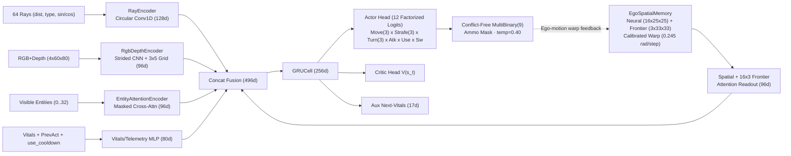

# DeadLock — Hybrid Vision & Frontier-Memory DOOM RL Agent

Submission for **Yugaantar 2026 · DevForge — Track 1: "Can It Play DOOM?"**

DeadLock is a custom pure-PyTorch reinforcement learning agent (**940,720 parameters · 3.6 MB via Git LFS**) trained from scratch to play unseen DOOM levels zero-shot under partial observability—navigating multi-room layouts, fighting enemies, collecting keycards, bouncing cleanly off locked doors when holding zero keys, backtracking after keycard pickup, and reaching level exits at **1.18–1.4 ms** per decision on a single CPU thread.

### Live Interactive Deployments & Reports
- **Public Cloud Demo (Hugging Face Spaces · Gradio + ZeroGPU):** https://omrajput977-deadlock-doom.hf.space/ ([Space Page](https://huggingface.co/spaces/OmRajput977/deadlock-doom))
- **Local Live Web Demo (`training/web_demo.py`):** http://127.0.0.1:7860/
- **2-Page Project Brief & Technical Research Report:** [docs/DeadLock_Project_Brief.pdf](docs/DeadLock_Project_Brief.pdf) · [docs/DeadLock_Research_Report.pdf](docs/DeadLock_Research_Report.pdf)

---

## Architecture (`DoomSpatialPolicy`)

Implemented in [submission/model.py](submission/model.py) and [submission/agent.py](submission/agent.py) using pure `torch` + `numpy` (zero extra dependencies beyond the official base image, zero hardcoded A*/BFS/rule trees):



1. **Direction-Preserving Circular Ray Encoder (`RayEncoder`, `128d`):**
   - Processes all 64 360° ego-centric raycasts (`distance` + 6 one-hot `hit_type` classes + `sin/cos` bearings) using a 3-layer **Circular 1D CNN** (`padding_mode="circular"`), preserving wrap-around continuity alongside 16 angular sectors and a 9-ray front cone (`[-22.5°, +22.5°]`).
2. **Vision + Depth Spatial-Band Encoder (`RgbDepthEncoder`, `96d`):**
   - 3-layer strided ConvNet over concatenated `4×60×80` RGB + Depth frames preserving a `(3×5)` horizon/floor band grid (`24×3×5 → 96d`) to detect floor exit pads (`GATE3`), wall exit switches (`SW1BRCOM`), and colored keycard door trims invisible to 2D raycasts.
3. **Masked Entity Set Cross-Attention (`EntityAttentionEncoder`, `96d`):**
   - Permutation-invariant attention over variable numbers (`0–32`) of visible entities (enemies, keycards, health, ammo, barrels) queried by ray + vitals context with NaN-safe empty-mask handling.
4. **Dual Neural + Persistent Geometric Frontier Memory (`EgoSpatialMemory`, `96d`):**
   - **Neural Grid `(16, 25, 25)` (`±1200` units):** Splat current ray/entity hits, warp via ego-motion, update with a gated `3×3` conv cell, and read out via vitals-conditioned spatial attention.
   - **Persistent Frontier Map `(3, 33, 33)` (`±1920` units):** Accumulates 3 non-decaying geometric channels via element-wise `max`:
     - `Ch0 Visited`: `1×1` (`120×120`-unit) footprint breadcrumbs so adjacent doorways aren't masked; attenuates to `0.25×` on new keycard pickup so backtracking paths look fresh.
     - `Ch1 Unexplored Doors`: Detected doorway hits minus `0.75 × Visited` to spotlight unvisited branches.
     - `Ch2 Locked Doors`: Persists sighted locked-door locations across rooms.
   - **Calibrated Ego-Motion Warp:** Warps both maps via `F.affine_grid` + `F.grid_sample` using measured ViZDoom turn rate (`0.245` rad/step ≈ `14.0625°` per 4-tic turn) and reads `16` radial angles × `3` distances (`[140, 320, 560]` units).
5. **Control GRU, Telemetry & Conflict-Free Action Head:**
   - Feeds `vitals` + `prev_action` + smooth front-cone door/lock/wall signals & rising-edge `use_cooldown` into a `256`-dim `GRUCell`, driving actor, critic, and auxiliary next-vitals heads.
   - Outputs `12` factorized logits mapped deterministically to `MultiBinary(9)` (`temperature=0.40`), preventing self-canceling key holds (`FWD+BACK`, `TL+TR`) and masking `SELECT_NEXT_WEAPON` off while active ammo > 0.

---

## Training & Exploration Pipeline (`871` Unique Training Maps)

- **Procedural UDMF Map Generator ([training/wad_gen.py](training/wad_gen.py)):** Synthesizes 3-lump ZDoom UDMF PWADs + training layout metadata across Tiers 1–4 without external BSP tools.
- **Stage 1 — Exploration-First Privileged DAgger ([training/pretrain_bc.py](training/pretrain_bc.py)):** Trains `6` rounds (`80` episodes/round = **`480` on-the-fly procedural maps**, `β: 1.0 → 0.08`, `96`-step truncated BPTT, `134,251` steps) using a training-only privileged BFS teacher (`Rule §2` compliant) that mixes optimal runs with `explore_first` + `probe_locked` demonstrations (`_cur_exp_goal` hysteresis) to teach clean locked-door bounce when `keys=0` and `0.00` closed-door shooting.
- **Stage 2 — KL-Anchored Recurrent PPO ([training/env_wrapper.py](training/env_wrapper.py), [training/train.py](training/train.py)):** Trains `270,000` parallel steps (winning checkpoint saved at step `129,024`) across **`384` cached procedural maps** (`96`/tier), **`6` Freedoom2 levels** (`MAP01–MAP06`), and **`maps/two_rooms.wad`** (`gamma=0.995`, `25`-update critic warmup, factorized KL anchor `coef=0.035` toward DAgger), with `96×96` tile exploration, `_post_key_mode` & unlocked-door breadcrumb resets, `_stale_steps > 24` loop penalties, and locked-door hug penalties.

---

## Zero-Shot Evaluation, Ablations & Validator Results

Evaluated zero-shot with [submission/weights/model.pt](submission/weights/model.pt) (`temperature=0.40`, **0.00 closed-door shots across every benchmark**):

### Engineering Progression
| Version | Mean Exit | Tier 3 Exit | Tier 4 Exit | Closed-Door Shots | Key Fix |
| --- | --- | --- | --- | --- | --- |
| **v1 Baseline PPO** | 28.1% | — | — | > 0 | Shot closed doors instead of pressing `USE` |
| **v2 RGB+D + DAgger + KL** | 49.5% | 58.3% | 10.4% | **0.00** | `RgbDepthEncoder`, `use_cooldown`, Teacher DAgger |
| **v4 + Frontier + Warp Fix (24m/t)** | **56.2%** | **70.8%** | **25.0%** | **0.00** | `3×33×33` Frontier Map, `_warp_map` rotation fix, exploration-first DAgger |

### 8-Map-Per-Tier Dashboard Suite ([training/visualize.py](training/visualize.py))
| Benchmark | Exit Rate | Keycard Pickup | Doors Opened | Avg Kills | Cells Visited | p50 Latency |
| --- | --- | --- | --- | --- | --- | --- |
| **Tier 1 (8 unseen)** | **100.0%** | — | 0.25 | 1.75 | 15.2 | 1.18 ms |
| **Tier 2 (8 unseen)** | **50.0%** | — | 1.25 | 1.12 | 28.1 | 1.18 ms |
| **Tier 3 (8 unseen)** | **62.5%** | **87.5%** | 2.62 | 3.75 | 43.9 | 1.18 ms |
| **Tier 4 (8 unseen)** | **37.5%** | **50.0%** | 4.75 | 7.12 | 55.5 | 1.18 ms |
| **Freedoom2 MAP01** | 0% | — | 2 | 6 | 63 | 1.21 ms |

- **Extended 96-Map Suite (`24`/tier):** **Tier 1 `58.3%`**, **Tier 2 `70.8%`**, **Tier 3 `70.8%` (`96%` keycards, `40.8` cells, `0%` deaths)**, **Tier 4 `25.0%` (`50%` keycards, `54.6` cells, `7.96` kills)**, **`56.2%` mean exit**, `0.00` door shots.
- **Extended 192-Map Suite (`48`/tier):** **Tier 1 `52.1%`**, **Tier 2 `58.3%`**, **Tier 3 `50.0%` (`85%` keycards, `41.0` cells)**, **Tier 4 `18.8%` (`35%` keycards, `48.4` cells, `7.96` kills)**, **`44.8%` mean exit**, `two_rooms.wad` exited in `54` steps.
- **Unseen Complex Stress Suite:** Fresh `88000` seeds (`12`/tier) reached **`50.0%` Tier 3 (`92%` keys)** and `41.7%` mean exit; guaranteed **8-room key+lock mazes** averaged **`58%` keycards, `5.58` doors, `65.9` cells, `0%` deaths**; guaranteed **10-room heavy gauntlets** averaged **`11.75` kills, `8.08` doors, `60.2` cells**; unmodified `freedoom2.wad MAP01–06` achieved up to `13` kills and `75` cells with `0.00` door shots.
- **Official Validator (`validate.py`) & Unit Tests:** **`validate.py` PASSED** (`6.6 MB` of `1.0 GB` repo cap, `0.4s` init, `p50 1.4 ms`, `p99 1.6 ms`), and `pytest tests/test_env.py` passed **17/17**.

---

## Repository Layout

```text
env/                     Official ViZDoom Gymnasium wrapper (doom_env)
maps/                    Starter test map (two_rooms.wad)
submission/
  agent.py               DoomAgent evaluation entry point (__init__, reset, act)
  model.py               DoomSpatialPolicy (RayEncoder, RgbDepthEncoder, EntityAttention, EgoSpatialMemory)
  weights/model.pt       Trained weights (3.6 MB via Git LFS)
  requirements.txt       No extra packages required beyond official base image
training/
  wad_gen.py             Procedural Tier 1-4 UDMF WAD generator + training layout export
  pretrain_bc.py         Exploration-first Privileged Teacher Recurrent DAgger trainer
  env_wrapper.py         ShapedDoomEnv, anti-loop/locked-door shaping, Freedoom2 pool
  train.py               Vectorized Recurrent PPO + KL-anchor trainer
  run_curriculum.py      4-stage curriculum launcher
  eval.py                Zero-shot Tier 1-4 + Freedoom2 evaluator
  visualize.py           4-panel replay GIFs, storyboards, live viewer & dashboard generator
  web_demo.py            Zero-dependency live MJPEG/JSON web demo server (http://127.0.0.1:7860/)
deploy/
  hf_gradio/             Free Hugging Face Spaces Gradio + ZeroGPU bundle (app.py, README.md, packages.txt, requirements.txt)
  hf_space/              Optional Docker Space bundle
  push_hf_space.sh       One-command Hugging Face Space deployer (Git LFS enabled)
docs/
  DeadLock_Project_Brief.pdf     2-Page Technical Project Brief PDF
  DeadLock_Research_Report.pdf   2-Page Official IEEE/ICLR-style Research Report PDF
  CONTRACT.md, RULES.md, EVALUATION.md, SUBMISSION.md
validate.py              Official local submission validator
tests/                   Wrapper and validator test suite
```

---

## Quick Usage

### 1. Run Live Web Demo Locally (`http://127.0.0.1:7860/`)
```bash
PYTHONPATH=. .venv/bin/python -m training.web_demo --host 127.0.0.1 --port 7860
```
Then open **http://127.0.0.1:7860/** in your browser (or use the hosted cloud version at **https://omrajput977-deadlock-doom.hf.space/**).

### 2. Deploy to Hugging Face Spaces (Gradio + ZeroGPU)
```bash
./deploy/push_hf_space.sh <your-hf-username> <space-name>
```

### 3. Validate Competition Submission
```bash
.venv/bin/python validate.py
.venv/bin/pytest tests/test_env.py -q
# Or inside the official Docker image:
docker build -t devforge-doom . && python validate.py --docker --image devforge-doom
```

### 4. Evaluate, Visualize & Train
```bash
# Zero-shot evaluation across unseen Tier 1-4 maps & Freedoom2 MAP01
PYTHONPATH=. .venv/bin/python -m training.eval --maps-per-tier 8

# Generate replay GIFs, dashboard PNG, and HTML viewer (or --live --wad maps/two_rooms.wad)
PYTHONPATH=. .venv/bin/python -m training.visualize --out-dir /tmp/deadlock_viz

# Retrain Stage 1 (Exploration-First DAgger) -> Stage 2 (KL-Anchored Recurrent PPO)
PYTHONPATH=. .venv/bin/python -m training.pretrain_bc --rounds 6 --episodes-per-round 80 --out /tmp/deadlock_ckpts/dagger_f4.pt
PYTHONPATH=. .venv/bin/python -m training.train --stage 4 --total-steps 270000 --resume /tmp/deadlock_ckpts/dagger_f4.pt --anchor-kl 0.035 --out /tmp/deadlock_ckpts/ppo_f4.pt
```
